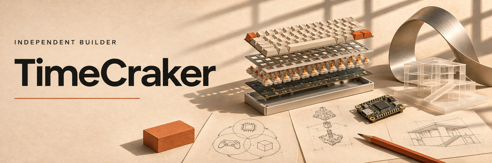

# 独立架构师 · 全栈 × AI × 硬件

我是张桓睿（TimeCraker）。我做 AI 产品、开发工具和游戏，也动手做硬件。从架构、实现到部署与运维，我把想法做成可以实际使用的系统。

[个人主站 ↗](https://asterforge.top) · [完整作品 ↗](https://asterforge.top/explore#projects) · [邮件联系](mailto:timecraker@foxmail.com)

## 01 / 精选作品

**[ccweb](https://github.com/TimeCraker/ccweb)** · 开发者工具 
把 Claude Code 的会话、实时工具调用和操作审批放进浏览器。基于 Claude Agent SDK，支持在本机运行。

**[ResuAIX ↗](https://resume.asterforge.top)** · AI 产品 
面向求职者的 AI 简历工具，支持编辑简历、润色经历和练习面试。

**[AsterNova](https://github.com/TimeCraker/games)** · 游戏开发 
一款实时联机 3D 动作游戏项目，包含 Godot 客户端和联机服务端。

**[蓝牙语音机械键盘 ↗](https://asterforge.top/explore#hardware)** · 硬件实践 
把机械键盘、PCB 与蓝牙语音模块整合进同一个自制硬件项目。

## 02 / 更多项目

- **[Lekao](https://github.com/TimeCraker/Lekao)**：面向教培机构的 AI 助教工作台，整理错题、课堂小结和课后反馈。
- **[vibe-studio](https://github.com/TimeCraker/vibe-studio)**：把演示文稿、逐页动效和 Remotion 视频串成一条内容制作流程。
- **[agent-hive](https://github.com/TimeCraker/agent-hive)**：批量调度 Claude Code 任务，查看并行执行进度。
- **[coding-plan-bench](https://github.com/TimeCraker/coding-plan-bench)**：比较 Coding 订阅方案的首字延迟、输出速率与总耗时。
- **[小饭桌 ↗](https://xiaofanzhuo.asterforge.top)**：社区扫码点餐与商家管理系统。

其他开源实验与工具

- [video-script-workflow](https://github.com/TimeCraker/video-script-workflow) · 短剧剧本、角色档案与分镜工作流。
- [claude-remote-deploy](https://github.com/TimeCraker/claude-remote-deploy) · Claude Code 远程部署与飞书 Bot 接入。
- [claude-web-terminal](https://github.com/TimeCraker/claude-web-terminal) · 浏览器里的 Claude 交互终端。

## 03 / 我的工具箱

**软件** · TypeScript、React、Next.js、Go、PostgreSQL 
**AI** · Agent SDK、工具调用、审批交互、本地推理 
**游戏与硬件** · Godot、蓝牙、语音、PCB、机械键盘

> 循此苦旅，以达天际。 
> *Per aspera ad astra.*
