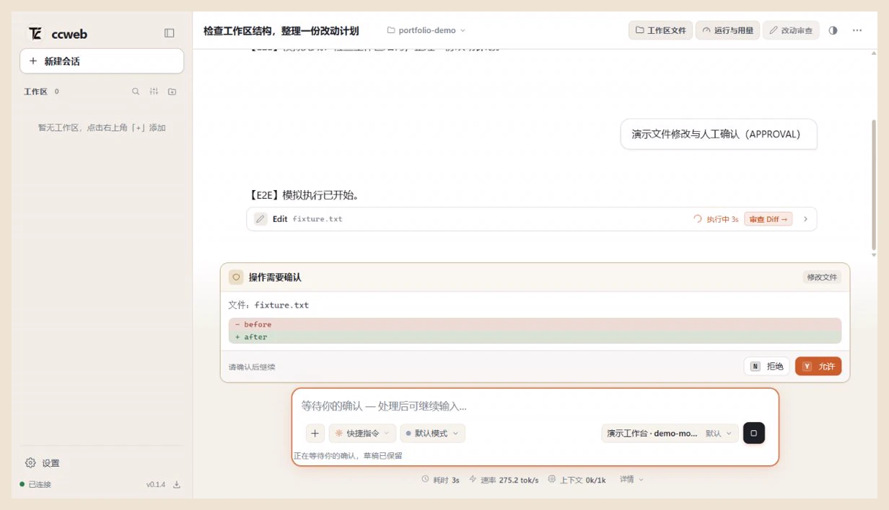
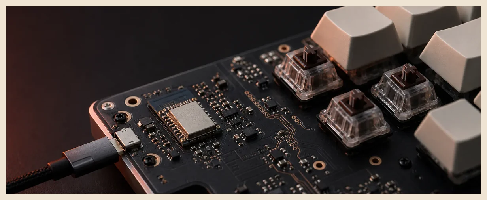

# 从想法到可运行的系统

我是 **TimeCraker**，一名独立开发者。做过本地 AI 开发工作台、求职工具、实时联机游戏和自制键盘。我喜欢把界面、服务和硬件连起来，也负责让做出来的东西能部署、能维护。

**[个人主站 ↗](https://asterforge.top)**　·　[完整作品](https://asterforge.top/explore#projects)　·　[邮件联系](mailto:timecraker@foxmail.com)

## 01 / 精选作品

### ccweb · Claude Code 本地工作台

在浏览器里管理 Claude Code 会话，查看任务进度、工具调用和文件改动，在需要时审批操作。适合在多个任务之间切换，同时保留每条会话的上下文。

FIG. 01 · 从当前源码构建的审批界面（e9b137d），使用模拟会话。 
**[查看源码与运行方式 ↗](https://github.com/TimeCraker/ccweb)**

### ResuAIX · AI 求职工具

从旧简历或一段原始经历开始，用 AI 梳理贡献、调整措辞，再按岗位管理版本。确认事实后，可以选版式并导出 PDF。

FIG. 02 · 公开产品页截图，画面使用示例简历。 
**[体验产品 ↗](https://resume.asterforge.top)** · [查看优化案例](https://resume.asterforge.top/cases)

### AsterNova · 实时联机游戏

用 Godot 搭建 3D 动作客户端，在 Go 服务端实现联机对战。这个项目把角色操作、场景与多人状态同步放进了同一套系统。

FIG. 03 · 为作品集生成的竞技场概念图。 
**[查看项目仓库 ↗](https://github.com/TimeCraker/games)** · [项目站](https://asterforge.top/game)

### 蓝牙语音机械键盘 · 硬件原型

在自制机械键盘上整合 PCB、轴体、蓝牙和语音模块，把物理输入与软件交互放进同一个原型。

FIG. 04 · 主站硬件项目配图。 
**[查看硬件实践 ↗](https://asterforge.top/explore#hardware)**

## 02 / 更多项目

- **[Lekao](https://github.com/TimeCraker/Lekao)** · 教培机构 AI 助教工作台，用于整理错题、课堂小结与课后反馈。
- **[vibe-studio](https://github.com/TimeCraker/vibe-studio)** · 从演示文稿与逐页动效，到 Remotion 视频的内容制作流程。
- **[agent-hive](https://github.com/TimeCraker/agent-hive)** · 批量调度 Claude Code 任务，追踪并行运行进度。
- **[coding-plan-bench](https://github.com/TimeCraker/coding-plan-bench)** · 对比 Coding 订阅方案的首字延迟、输出速率与总耗时。
- **[小饭桌](https://xiaofanzhuo.asterforge.top)** · 社区扫码点餐与商家管理系统。

其他开源实验与工具

- [video-script-workflow](https://github.com/TimeCraker/video-script-workflow) · 短剧剧本、角色档案与分镜工作流。
- [claude-remote-deploy](https://github.com/TimeCraker/claude-remote-deploy) · Claude Code 远程部署与飞书 Bot 接入。
- [claude-web-terminal](https://github.com/TimeCraker/claude-web-terminal) · 浏览器里的 Claude 交互终端。

## 03 / 关于构建

**软件与部署** · TypeScript、React、Next.js、Go、PostgreSQL 
**AI 工程** · Agent SDK、工具调用、人工审批、本地推理 
**游戏与硬件** · Godot、PCB、蓝牙、语音交互

> 循此苦旅，以达天际。 
> *Per aspera ad astra.*
